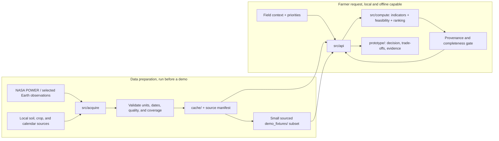

# Field Shift pipeline and architecture

**Status: design only.** The current Next.js app in `prototype/` uses illustrative values. No acquisition job, scientific compute service, API, or runtime agent is connected. This document defines how those parts should fit together when they are built.

The [mandatory-now context](MVP_SCOPE.md) and [future roadmap](FUTURE_ROADMAP.md) define the two scopes. Start with one reviewed pilot; runtime AI/fertilizer/nutrient-depletion features are excluded from MVP.

## Two paths through the system



The frontend sends field context and preferences to the API; it does not call NASA directly. Acquisition downloads and prepares data separately. The API serves local cache or a committed fixture and calls deterministic compute functions. During an offline demo, `OFFLINE=1` must prevent network access. If the needed local dataset is absent, the API should return an explicit unavailable state instead of inventing a result.

## Step by step

| Step | Owner | Input → output | Required check |
| --- | --- | --- | --- |
| 1. Collect | `src/acquire/` | NASA and permitted local sources → raw saved files | Record product ID/version, URL or DOI, retrieval time, area, dates, license, and checksum. |
| 2. Prepare | `src/acquire/` | Raw files → cleaned daily or seasonal tables in `cache/` | Check fill values, quality flags, units, time standard, missing days, and grid-to-field scale. |
| 3. Freeze demo | `demo_fixtures/` | Small sourced subset → repeatable offline input | Include manifest and processing command; never substitute mock UI values for observations. |
| 4. Describe field | Frontend → `src/api/` | Location, soil, water, crop history, priorities → validated request | Distinguish measured values, farmer reports, estimates, and unknowns. |
| 5. Compute | `src/compute/` | Prepared evidence + field context → indicators, feasible rotations, contributions | Pure, tested functions; no model-generated numbers. Agronomic thresholds require local review. |
| 6. Gate | API/provenance validator | Computed result → approved result or unavailable response | Every displayed claim has units, method, period, spatial support, and a source ID/URL. |
| 7. Explain | API → frontend | Approved result → rotation choice, reasons, trade-offs, chart data | Display data mode, assumptions, and uncertainty in Bangla/English. |

For the pilot, the first acquisition target is [NASA POWER daily data](DATA_SOURCES.md). IMERG, SMAP, and MODIS are additions only when they answer a specific rotation question and pass the same provenance checks. Rainfall onset and growing degree days can inform *when* a rotation is feasible; the main output remains a comparison of crop sequences for the [official Field Shift challenge](https://www.spaceappschallenge.org/2026/challenges/field-shift-adapting-farms-with-nasa-data/).

## Draft result contract

[API_CONTRACT](API_CONTRACT.md) is the G0 draft source of truth. Request: short field/history/water/preset input, usual baseline/fallow and common horizon. Response: separate bundle/plan statuses, baseline assessment, distinct three-future-crop alternatives, check ledger, indicators, missing-information actions and source/catalogue/method identities. Complete bundle requires an assessed baseline and at least two distinct complete alternatives; a baseline can be infeasible but assessed.

Intended-crop assessment reuses compute checks. One historical replay changes only declared climate inputs. Print/JSON consume the same result with stable canonical fingerprints and limitations, not browser-recomputed science. Fixed translated reason labels provide explanations without an LLM. Soil outputs remain compatibility/management potential, not measured nutrient restoration.

Use cache/verified_fixture/unavailable modes; current illustrative constants are neither real cache nor verified fixtures. Preserve observations when priorities change and expose essential unknowns.

## Deferred optional agent extension

Runtime agents are **future only, after accepted MVP and explicit new scope approval**. The first complete system can use fixed templates to explain compute results. If the team later adds an agent, place its orchestration and tool schemas in `src/agents/` beside the API:

```text
question / field request
  → retrieve approved local evidence and compute results through tools
  → draft a Bangla or English explanation from those results
  → check each numeric claim against a returned value and source
  → publish the explanation, or fall back to a fixed template
```

The agent may select approved tools, assemble a workflow, and phrase explanations. It must not calculate onset, statistics, crop feasibility, rotation scores, or missing values. Tool responses need typed values plus dataset IDs and URLs. A provenance gate should reject unsupported claims before display, with a finite step limit and a safe fallback. An MCP server is only useful if it exposes a needed, tested capability; it is not required to complete the core pipeline.

## Build order and acceptance points

1. Agree a pilot district, crop sequences, local data sources, and agronomic rules.
2. Acquire one NASA POWER sample with a reproducible manifest and quality checks.
3. Implement and test the deterministic indicators and feasibility logic.
4. Serve one rotation comparison from a local fixture through the API, with no network access.
5. Replace the prototype's illustrative result path only after the API result is traceable and validated.
6. After G3, complete the compact story/receipt and G4 historical replay/offline validation; G5 handles authorized release.
7. Additional datasets and agents remain blocked future tracks until separately activated.

The methodology and validation questions are in [METHODOLOGY.md](METHODOLOGY.md); source candidates are in [DATA_SOURCES.md](DATA_SOURCES.md). No UI work is part of this document-only step.
